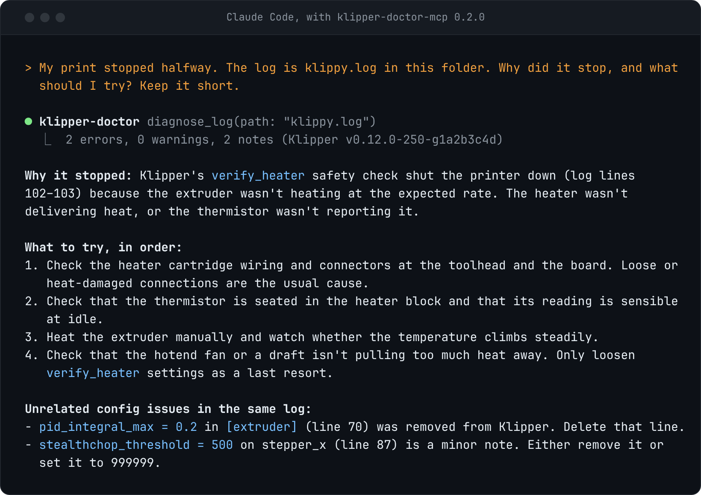

# klipper-doctor-mcp

Ask your AI agent why a Klipper print stopped. This server gives it [klipper-doctor](https://github.com/kd-011/klipper-doctor)'s rules for `klippy.log` and `printer.cfg`, so the answer names the cause and cites the Klipper docs or source it comes from. It is read-only: it never moves, heats or writes anything on the printer.

<picture>
  <source media="(max-width: 600px)" srcset="assets/session-hero.png">
  
</picture>

The picture is a real Claude Code session against this server, recorded by `scripts/record-session.mjs` and drawn by `scripts/render-assets.mjs`. The log is `test/fixtures/heater-verify.log`, a synthetic one built from Klipper's message formats.

## Try it

You need Node 18 or newer and an MCP client. This is for Claude Code; [other clients](docs/clients.md) are a config snippet.

```sh
claude mcp add klipper-doctor -- npx -y github:kd-011/klipper-doctor-mcp
curl -sO https://raw.githubusercontent.com/kd-011/klipper-doctor-mcp/main/test/fixtures/heater-verify.log
claude "My print stopped. The log is heater-verify.log in this folder. Why, and what should I try?"
```

The package is not on npm yet, which is why the command points at GitHub. npm builds it on the first start, which took about 20 seconds from a cold cache on my machine. If your client gives up before that, run `npx -y github:kd-011/klipper-doctor-mcp --version` once in a terminal and add it again.

For your own printer, add `MOONRAKER_URL` and the agent can fetch `klippy.log` and `printer.cfg` itself:

```sh
claude mcp add klipper-doctor -e MOONRAKER_URL=http://printer.local:7125 -- npx -y github:kd-011/klipper-doctor-mcp
```

Or run Claude Code on the printer's host and let it read `~/printer_data/logs/klippy.log`.

## What it gives the agent

Five tools: `diagnose_log` (why a print or session died, plus a lint of the config Klipper wrote into the log), `lint_config`, `list_rules`, `explain_rule` and `printer_status`. The log can be pasted text, a file path, or fetched from Moonraker. [The reference](docs/reference.md) has the inputs and settings, and [an example report](docs/example.md) shows the text the agent gets back.

The code enforces read-only. The Moonraker client can only send `GET` to a short list of read endpoints, every tool is marked read-only, and a test fails if any request leaves that list. Logs can contain hostnames, usernames, IP addresses and serial numbers, and whatever the agent reads goes to your AI provider, so check what you share. `KLIPPER_DOCTOR_ALLOWED_DIRS` limits which files it can open.

## Other tools

Searched in November 2026. Most Klipper MCP servers on GitHub are about control. [Charleslotto/klipper-mcp](https://github.com/Charleslotto/klipper-mcp) exposes over a hundred tools including G-code, print control and TMC drivers. [nixkor/moonraker-mcp](https://github.com/nixkor/moonraker-mcp) controls prints with a confirmation step on risky calls. [mikehatch/KlipperMCP](https://github.com/mikehatch/KlipperMCP) reads and edits config files. [OctoEverywhere](https://blog.octoeverywhere.com/mcp-server-for-3d-printing/) runs a hosted MCP server for several printer types. In that search I did not find one that applies rules to `klippy.log`. I have run none of them, so this is from their READMEs.

They run next to this one. If you want your agent to drive the printer, use one of those. If you want it to work out why Klipper stopped, with sources, use this.

## When not to use it

- You have no Klipper. It knows nothing about Marlin or Bambu printers.
- The failure left no trace in `klippy.log`. A wobbly bed or a clogged nozzle will not show up.
- You just want a report. The [klipper-doctor CLI](https://github.com/kd-011/klipper-doctor) does the same analysis with `npx klipper-doctor klippy.log`, and [hotend.app/klipper-doctor](https://hotend.app/klipper-doctor) does it in a browser with nothing installed.
- You cannot send a log to an AI provider. The analysis itself runs locally, but the agent then reads the result and the log.

More limits are in [the reference](docs/reference.md#limits).

## Develop

```sh
git clone https://github.com/kd-011/klipper-doctor-mcp
cd klipper-doctor-mcp
npm ci && npm test
```

See [CONTRIBUTING.md](CONTRIBUTING.md). A wrong diagnosis is a [klipper-doctor](https://github.com/kd-011/klipper-doctor) issue, since the rules live there. MIT licence, release notes in [CHANGELOG.md](CHANGELOG.md).
