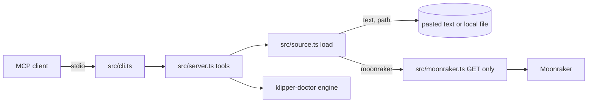

# klipper-doctor-mcp: how it is built

A single Node process written in TypeScript. An MCP client starts it and talks to it over stdio. It registers five read-only tools, turns the caller's input into text, and hands that text to the `klipper-doctor` package, which holds every rule. <!-- src: src/cli.ts, src/server.ts:66-180, package.json#dependencies -->

## Components

- `src/cli.ts` is the `klipper-doctor-mcp` binary. It handles `--help` and `--version`, reads the environment into a `Context`, and connects the server to a stdio transport. <!-- src: src/cli.ts:23-41, package.json#bin -->
- `src/server.ts` registers `diagnose_log`, `lint_config`, `list_rules`, `explain_rule` and `printer_status`, each with `readOnlyHint` and a zod output schema. It sends an `instructions` string to the client. Every handler runs inside `guard`, which returns known errors as tool errors and replaces anything unexpected with a fixed message. <!-- src: src/server.ts:12-180 -->
- `src/source.ts` turns the input into text: exactly one of pasted `text`, a local `path`, or `moonraker: true`. It applies the allowed-directories fence and a 64 MiB size cap. <!-- src: src/source.ts:9-79 -->
- `src/moonraker.ts` is the only code that touches the network: a client that can send `GET` to a short list of read paths, with header auth, a redirect ban, a size cap and per-wait timeouts. <!-- src: src/moonraker.ts:1-16, src/moonraker.ts:73-122 -->
- `src/index.ts` is the package entry (`main`): it re-exports `createServer`, `VERSION`, the Moonraker client and error, and `READ_ONLY_PATHS`. <!-- src: src/index.ts, package.json#main -->
- The analysis is the `klipper-doctor` npm package: `analyze`, `verdict`, `countBySeverity`, `toMarkdown` and `rulesMetadata`. This repo adds no rules. <!-- src: src/server.ts:3, package.json#dependencies.klipper-doctor -->
- `scripts/` holds repo tooling, none of it shipped: fixtures, the demo block, the recorded-session pictures and the release planner. `package.json#files` ships only `dist`, `server.json`, `README.md` and `LICENSE`. <!-- src: package.json#files, scripts/release.mjs:1-12 -->
- `test/` runs the built binary over stdio with an SDK client, against synthetic fixtures and a fake Moonraker HTTP server that records every request. <!-- src: test/helpers.mjs:13-60 -->

## Data flow

- A tool call arrives over stdio and reaches the handler in `src/server.ts`. <!-- src: src/server.ts:79-87 -->
- `load` checks that exactly one source was given. Pasted text is used as is. A path is expanded (`~`), resolved through `realpath`, checked against the allowed directories, then read if it is a regular file under the size cap. <!-- src: src/source.ts:39-79 -->
- With `moonraker: true`, `load` asks the client for `klippy.log` (top-level endpoint first, the `logs` root on a 404) or for a config file under `/server/files/config/`. <!-- src: src/source.ts:49-56, src/moonraker.ts:133-145 -->
- The text goes to `analyze` from klipper-doctor, with the filename `klippy.log` or `printer.cfg`. `lint_config` keeps only the config findings. <!-- src: src/server.ts:81-82, src/server.ts:105-108 -->
- The reply is the engine's Markdown plus a line of rule ids, and the full report as structured content. <!-- src: src/server.ts:45-49, src/server.ts:83-86 -->
- `printer_status` makes two `GET`s to Moonraker (`/printer/info`, then `/printer/objects/query?print_stats&webhooks`). If the second fails it still answers, with a warning. <!-- src: src/moonraker.ts:147-166 -->
- `list_rules` and `explain_rule` read `rulesMetadata()` from the engine and touch no input or network. <!-- src: src/server.ts:127-152 -->

## Storage

None. Input is read, analysed and returned; the server writes no file and keeps no state between calls. <!-- src: src/source.ts:59-79, src/server.ts:51-61 -->

## Auth

- The server has no login of its own: access is whatever the MCP client that launched it over stdio has. <!-- src: src/cli.ts:23-41 -->
- Local file access is open to any file the process can read, unless `KLIPPER_DOCTOR_ALLOWED_DIRS` is set. Then a path must resolve, after symlinks, inside one of the listed directories. A list that resolves to nothing allows nothing. <!-- src: src/source.ts:64-69, src/source.ts:81-94 -->
- Towards Moonraker, `MOONRAKER_API_KEY` goes as `X-Api-Key` and `MOONRAKER_TOKEN` as a Bearer header. Credentials in the URL are refused, redirects are not followed, and neither value appears in error text or the startup line. <!-- src: src/moonraker.ts:54-63, src/moonraker.ts:97-102, src/cli.ts:39-40 -->
- Read-only is enforced in code: there is no method for anything but `GET`, a path outside `READ_ONLY_PATHS` (or with a traversal segment, or an unexpected query) is refused before any request, and `config_file` must be a relative path inside the config root. <!-- src: src/moonraker.ts:9-19, src/moonraker.ts:174-199 -->

## External services

- Moonraker, optional, at `MOONRAKER_URL` (with `MOONRAKER_API_KEY` and `MOONRAKER_TOKEN` as needed). It is the only host the server contacts, and only when the URL is set. <!-- src: src/cli.ts:25-34, src/moonraker.ts:1-5 -->
- npm and the MCP registry are reached by CI and the publish workflow, not by the running server (`NPM_TOKEN` for the first publish). <!-- src: .github/workflows/publish.yml:1-30, server.json -->

## Unverified

- Whether the Moonraker paths and responses match every Moonraker version: the code and tests use a fake Moonraker, and no run against a real one is recorded in the repo.
